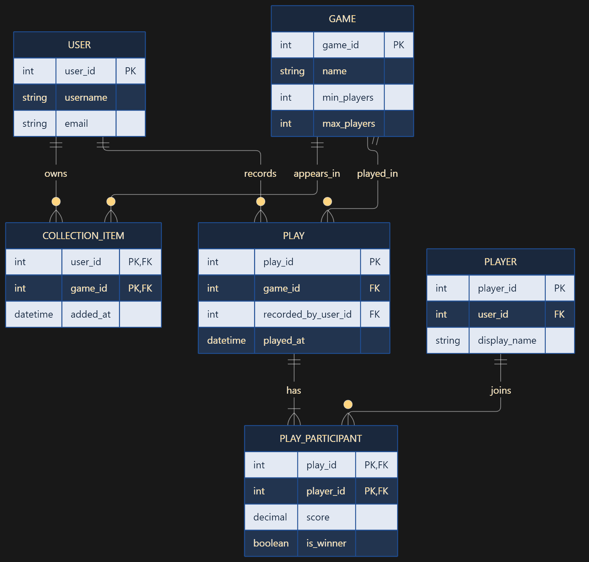
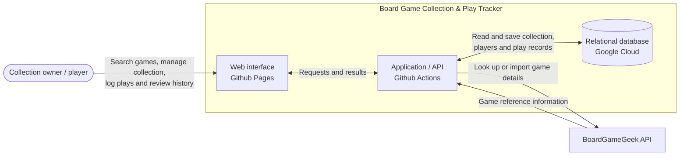

# Board Game Collection & Play Tracker

You can find the active board game tracker website [here](https://fbiagent42.github.io/board_game_tracker/)

## Project overview

This project is a personal catalog for board games and a play log for game sessions. It brings game details, BoardGameGeek (BGG) reference information, collection ownership, players, results, and session notes together in one place.

The goal is to make it easy to answer questions like “What games do I own?”, “When did we last play this?”, and “Who played, and how did it go?” Game records can use BGG information to reduce manual entry, while collection and play records capture each user's own details and history.

## Initial ERD

The initial data model separates shared game information from personal collection and play history. `COLLECTION_ITEM` connects users to the games they own, while `PLAY_PARTICIPANT` connects each play session to the players and their results.

## Rough system design

The implementation stack has not been selected yet. This technology-neutral sketch shows the planned components and the main information flow; the specific web, API, and database technologies are **TBD**.

## Goals

- Keep an accurate, searchable record of owned board games.
- Reduce manual data entry by importing game details from BoardGameGeek when available.
- Record each playthrough, including who played, how the game ended, scores, and useful context.
- Make it easy to look back at plays, compare results, and see how often games reach the table.
- Keep imported reference information distinct from personal collection details and play history.

## Planned features

### Collection catalog

- Add a game by searching its title or entering its BGG ID.
- Import available BGG details such as the canonical title, year published, player-count range, playing time, age recommendation, categories, mechanics, description, designer, publisher, and BGG link.
- Review imported details before saving them, and allow personal corrections where appropriate.
- Track ownership-specific information separately: owned status, edition, condition, language, acquisition date, price, location, and notes.
- Search, sort, and filter the collection by title, player count, play time, category, mechanic, ownership status, and other available details.
- Support expansions and standalone games, with a way to associate an expansion with its base game.

### Play logging

Each playthrough is a separate record associated with a game. A play record can include:

- Date and, optionally, start time and duration.
- Location or venue, such as home, a game night, or a convention.
- The players involved, including a host or other session roles if useful.
- Scores and player-specific results, including winner, placement, team, or tie status.
- Session-level details such as play count, game mode, scenario, round, difficulty, or variants used.
- Which expansions or modules were used.
- Notes about the session, memorable moments, or house rules.

The exact fields can vary by game. Some games need a simple winner and final score; others benefit from teams, multiple scoring categories, cooperative outcomes, or scenario-specific details. The data model should allow optional game-specific metadata without making a basic log cumbersome.

### Players and history

- Maintain reusable player profiles so names do not need to be re-entered for every play.
- Allow a player to be marked as a guest or represented by a display name without requiring a full account.
- View an individual's play history, games played, wins, and other recorded results.
- Keep player statistics descriptive and configurable; statistics should be based only on the plays and scoring details actually recorded.

### Collection and play insights

Potential views and summaries include:

- Plays by game, player, date range, or location.
- Most-played and least-played games.
- Recent plays and games that have not been played recently.
- Player counts and typical session duration based on logged sessions.
- Results and win rates where the recorded game format makes them meaningful.

## BoardGameGeek data

BGG is the source for external game reference data; the collection and play history are personal records owned by this application. A game should retain its BGG identifier and link when one is available, so imported information can be matched to the correct listing and revisited later.

### BGG API scripts

The local scripts read `BGG_KEY` from `config.secret.json` (or the `BGG_KEY` environment variable). Keep that file private.

- Fetch one example: `python scripts/scrape_bgg.py --ids 224517 --output data/bgg_sample.jsonl`
- Scrape IDs from `data/boardgames_ranks.csv`: `python scripts/scrape_bgg.py`
- Update recent publication years in Supabase: `python scripts/update_from_bgg.py --recent-years 2`

The scraper saves the API's XML fields as JSON Lines, including ratings/ranks, player and time recommendations, categories, mechanics, designers, artists, publishers, families, and implementations. It requests up to 20 games per API call and waits at least five seconds between calls. It resumes by skipping IDs already present in the output. `--include-versions` adds edition/version data and can make the output much larger.

BGG's documented API does not provide a supported “added since” or publication date-range filter. The recent-year updater therefore filters the local ranks CSV by `yearpublished`; to discover newly listed games, that CSV must be refreshed first. A full scrape of the current 183k-ID snapshot would take at least about 12.7 hours at the required request interval, before retries and processing.

## Authentication and collection management

The GitHub Pages app asks for a username, email, and password at signup; users sign in with their username and password. Supabase Auth stores the email for account management. Email confirmation is disabled in the Supabase project, so signup returns an active session without a confirmation email. This avoids the built-in email sender's two-per-hour cap, but Supabase still rate-limits signup requests by IP ([current Auth limits](https://supabase.com/docs/guides/auth/rate-limits)). The browser only receives the public anon key; username login is proxied through an Edge Function, and collection access is restricted by row-level security to the signed-in account. New Auth accounts get an application profile through the database trigger in `supabase/migrations/20261127000100_user_auth.sql`.

The auth migration has been applied and recorded in Supabase, and the `bgg-enrich`, `bgg-import-collection`, and `username-sign-in` Edge Functions are deployed. The BGG importer uses the existing `BGG_KEY` function secret; never place that key in `config.public.json` or browser code. The Supabase Auth Site URL and redirect URL should include `https://fbiagent42.github.io/board_game_tracker/`.

The remaining release step is to publish the updated static site to GitHub Pages. The migration disables anonymous reads of user profiles and collections, so the currently published username-only page cannot read collections until the new site is pushed.

The old collection rows under application user ID 1 remain in the database but are no longer visible to anonymous visitors or automatically assigned to a new Auth account. A signed-in user can save a BGG username under Connect BGG and import that public collection; this does not authenticate with BGG or access a private collection. Adding a game from search uses a database function that preserves any play count already recorded for that game.

